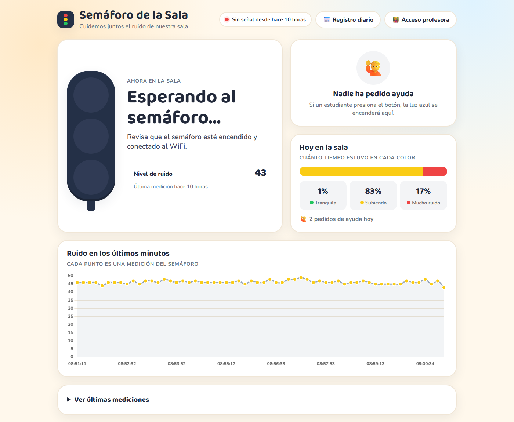
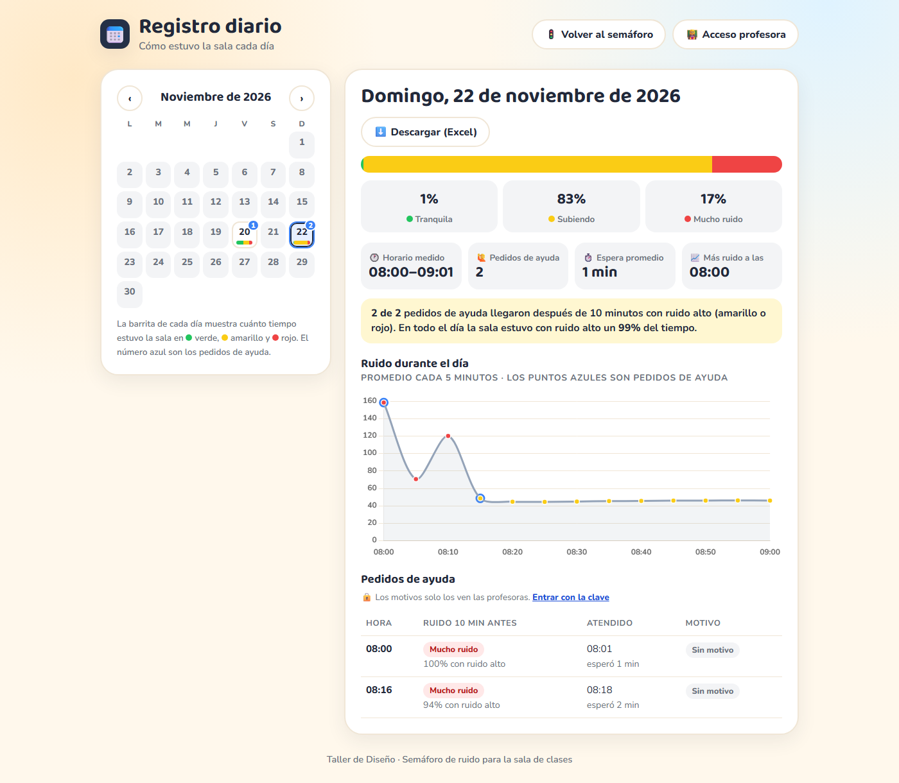

# Semáforo de Ruido para la Sala de Clases

Sistema IoT que mide el ruido de la sala, lo muestra como un semáforo (verde, amarillo y rojo) y deja que un estudiante pida ayuda en silencio con un botón en su escritorio. La profesora ve todo en una página web, apaga la luz de ayuda con su clave y anota el motivo. Cada día queda registrado para que el equipo docente relacione el ruido con lo que pasa en el curso.

**Página en vivo:** https://semaforoenlinea.up.railway.app · **Registro diario:** https://semaforoenlinea.up.railway.app/registro.html

## Información del equipo

- **Integrantes**
  - Matilda Steiner
  - Isidora Parra
  - Isidora Vidal
  - Florencia Gutiérrez
- **ODS seleccionados**
  - ODS 4, Educación de calidad
  - ODS 10, Reducción de las desigualdades
- **Problema a resolver** La falta de herramientas didácticas atractivas que ayuden a niños con Trastorno del Espectro Autista (TEA) ante crisis provocadas por la desregulación del ruido ambiental, cuando este supera su umbral de tolerancia acústica.

## Descripción del proyecto

La solución IoT es un sistema de detección acústica y comunicación audiovisual silenciosa, compuesto por dos unidades conectadas: el **módulo central**, junto a la pizarra, y el **módulo del estudiante**, en su escritorio. Funciona con una lógica de doble entrada (automática y manual) pensada para prevenir desregulaciones sin agregar ruido a la sala.

- **Entrada automática.** El módulo central mide el ruido de la sala en tiempo real con un micrófono y enciende una luz tenue: verde cuando se respeta el umbral, amarilla cuando está pronto a superarse y roja cuando se supera. El umbral de tolerancia promedio en niños con TEA e hipersensibilidad auditiva está entre 50 y 60 dB.
- **Entrada manual.** El estudiante tiene en su escritorio un botón que enciende una luz de aviso en la pizarra si siente sobrecarga o angustia sensorial antes de que se alcance el umbral.
- **Respuesta docente.** La profesora identifica la necesidad de forma inmediata y silenciosa, baja el volumen del grupo o interviene, y luego marca la ayuda como atendida desde la página web.
- **Registro en la nube.** El módulo central manda cada medición y cada pedido de ayuda a un servidor en Railway, que los guarda en PostgreSQL (Aiven). La página muestra el estado en vivo, un calendario con el reporte de cada día y la relación entre el ruido y los pedidos de ayuda.



*Captura real de la página publicada (`software/web/public/index.html`).*



*Captura real del registro diario con los datos que mandó el ESP32 el 22-11-2026.*

## Arquitectura

```
Botón del estudiante ──WiFi local──► ESP32 central (pizarra) ──► LED RGB del semáforo + luz de ayuda
   (ESP32-S3 SuperMini)                    │
                                           │ HTTPS + JSON, cada 10 s
                                           ▼
                           Servidor Node.js + Express (Railway) ──SQL con SSL──► PostgreSQL (Aiven)
                                           ▲
                                           │ cada 3 s
                         Página web: semáforo en vivo, acceso profesora y registro diario
```

## Estado del proyecto

- **Versión actual** v3, prototipo conectado a la nube
- **Última actualización** 22-11-2026
- **Estado** El semáforo, el envío de datos, la página web, el acceso de la profesora y el registro diario funcionan con el hardware real. Faltan la validación con usuarios, el modelo 3D completo, los planos, las fotos del prototipo y los documentos finales. Ver [Pendientes](#pendientes).

## Resultados clave

| Medida | Resultado | Origen |
|---|---|---|
| Mediciones enviadas por el ESP32 a la nube | 332 en 1 hora (08:00 a 09:01) | Real, prueba del 22-11-2026, [datos](testing/datos/mediciones_esp32.csv) |
| Intervalo promedio entre envíos | 11.0 s (configurado en 10 s) | Real, misma prueba |
| Cortes de conexión de más de 30 s | 4 en la hora, el más largo de 141 s | Real, misma prueba |
| Pedidos de ayuda registrados y atendidos desde la página | 2 de 2 | Real, [datos](testing/datos/pedidos_de_ayuda.csv) |
| Tiempo hasta que la profesora apagó la luz | 45 s y 126 s | Real, misma prueba |
| Validación con usuarios (mínimo 5) | Pendiente | Ver [testing](testing/README.md) |

## Estructura del repositorio

```
├── FUENTES.md          Fuentes, librerías y uso de IA (requisito habilitante)
├── hardware/           Esquema, BOM, fotos y selección de componentes
├── software/
│   ├── src/            Código de los ESP32 (central, botón, versión con nube y pruebas)
│   ├── web/            Servidor y página web (Railway + Aiven)
│   ├── docs/           Captura y datos, API y capturas de la página
│   └── librerias/      Dependencias y versiones
├── diseno_3d/          Modelos, planos y renders
├── testing/            Protocolo, reportes, datos y evidencias
├── documentacion/      Reporte final y presentación
└── iteraciones/        Historial de versiones v1, v2 y v3
```

## Dónde está cada criterio de la rúbrica

| Dimensión | Criterio | Dónde mirarlo |
|---|---|---|
| Software 30 % | Captura de datos | [software/docs/captura_y_datos.md](software/docs/captura_y_datos.md) |
| | Repositorio de datos | [software/docs/captura_y_datos.md](software/docs/captura_y_datos.md) y [software/web/server.js](software/web/server.js) |
| | Dashboard y visualización | [software/web/public](software/web/public) y [capturas](software/docs/img) |
| | Generación de información | [software/docs/captura_y_datos.md](software/docs/captura_y_datos.md) |
| | Calidad del código | [software/README.md](software/README.md) y [software/src/README.md](software/src/README.md) |
| Hardware 30 % | Selección de componentes | [hardware/README.md](hardware/README.md) |
| | Esquemático y BOM | [hardware/esquemas](hardware/esquemas) y [hardware/bom](hardware/bom) |
| | Montaje físico | [hardware/fotos](hardware/fotos) (pendiente) |
| | Diseño para la reparación | [hardware/README.md](hardware/README.md) |
| Diseño 3D 20 % | Gemelo 3D y modelado | [diseno_3d/fusion360](diseno_3d/fusion360) (pendiente) |
| | Renders | [diseno_3d/renders](diseno_3d/renders) |
| | Planos técnicos | [diseno_3d/planos](diseno_3d/planos) (pendiente) |
| Testing 10 % | Protocolo de pruebas | [testing/reportes/protocolo_pruebas.md](testing/reportes/protocolo_pruebas.md) |
| | Análisis de resultados y validación | [testing/README.md](testing/README.md) |
| GitHub 5 % | Estructura y respaldo | Este repositorio y su historial de commits |
| Presentación 5 % | Claridad, demo y preguntas | [documentacion/presentacion](documentacion/presentacion) |
| Proceso iterativo | Versiones v1, v2 y v3 | [iteraciones](iteraciones/README.md) |

## Componentes para replicar el hardware

| Módulo | Componentes |
|---|---|
| Central (pizarra) | ESP32 DevKit, micrófono KY-038, LED RGB de cátodo común, LED azul, cargador USB de 5 V, caja de MDF de 10 × 17 × 8 cm |
| Botón (escritorio) | ESP32-S3 SuperMini, pulsador, batería LiPo de 3,7 V |
| Internet | Celular con hotspot de 2.4 GHz |

Conexiones y pines en [hardware/bom](hardware/bom/README.md).

## Inicio rápido

### Requisitos previos

- Arduino IDE 2.x con el paquete de placas ESP32 de Espressif
- Librería ArduinoJson 7 (desde el Library Manager), solo para la versión con nube
- Node.js 18 o superior, solo para correr la página en el computador
- Un celular con hotspot de 2.4 GHz para darle internet al ESP32

### Ver el sistema funcionando

Abrir https://semaforoenlinea.up.railway.app. Si el ESP32 está encendido y con internet, el semáforo se actualiza solo.

### Cargar los ESP32

1. Abrir `software/src/central_nube/central_nube.ino` en Arduino IDE.
2. Cambiar `WIFI_SSID`, `WIFI_PASS` y `API_KEY` por los datos reales. **No subir esos datos a GitHub.**
3. Elegir la placa **ESP32 Dev Module**, el puerto y subir.
4. Cargar el botón del estudiante (`software/src/boton_estudiante`) en la ESP32-S3 SuperMini (placa **ESP32S3 Dev Module**, *USB CDC On Boot* activado).

Los detalles, la configuración de la base de datos y cómo correr el servidor en el computador están en [software/README.md](software/README.md).

## Checklist de entrega

### Hardware

- [x] Esquema del circuito, [simulación en Wokwi](hardware/esquemas/README.md)
- [x] Lista de componentes, [BOM](hardware/bom/README.md) con precios de referencia (total ≈ $45.000)
- [ ] Fotos de alta resolución del prototipo armado

### Software

- [x] Código comentado, [software/src](software/src) y [software/web](software/web)
- [x] Librerías documentadas, [software/librerias](software/librerias/README.md) y [FUENTES.md](FUENTES.md)
- [x] Manual de instalación, [software/README.md](software/README.md)
- [x] Captura, repositorio de datos y dashboard, [captura_y_datos.md](software/docs/captura_y_datos.md)

### Diseño 3D

- [ ] Archivo 3D con todos los componentes
- [x] Renders, [diseno_3d/renders](diseno_3d/renders)
- [ ] Planos técnicos

### Testing

- [x] Protocolo de pruebas, [protocolo_pruebas.md](testing/reportes/protocolo_pruebas.md)
- [x] Datos cuantitativos del sistema, [testing/datos](testing/datos)
- [ ] Reporte de testing con usuarios (mínimo 5)
- [ ] Evidencias fotográficas o en video

### Documentación

- [ ] Reporte final (máximo 15 páginas)
- [ ] Presentación (10 minutos)

## Pendientes

- Fotos del prototipo armado, modelo 3D completo y planos.
- Pruebas con al menos 5 usuarios reales, con evidencia.
- Reporte final y presentación.

## Licencia

Este proyecto se desarrolló como parte del curso TEI201, Taller de Diseño en Ingeniería, de la Facultad de Ingeniería y Ciencias de la Universidad Adolfo Ibáñez. El código se distribuye bajo licencia MIT, ver [LICENSE](LICENSE).
