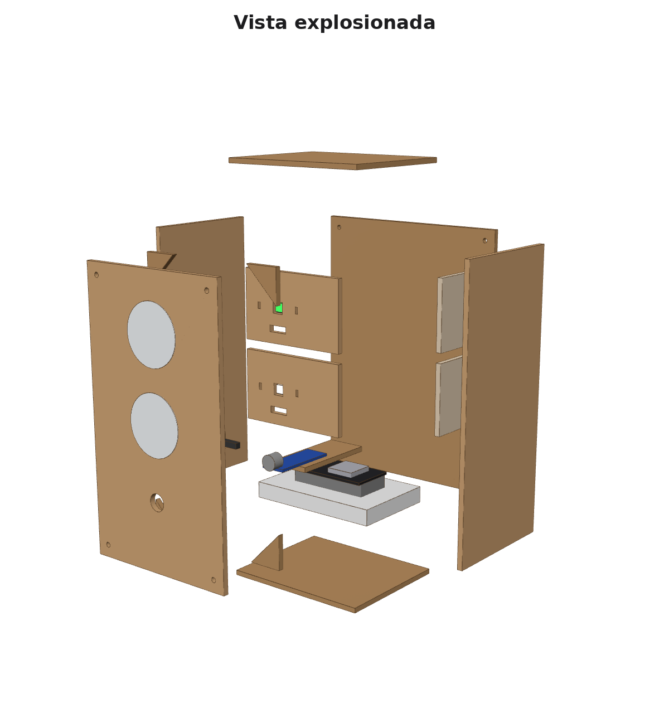

# Diseño 3D

Encapsulados de los dos módulos del sistema: la caja del semáforo, que va junto a la pizarra, y la carcasa del botón, que va en el escritorio del estudiante.

## Carpetas

| Carpeta | Contenido |
|---|---|
| [renders/](renders/README.md) | Renders de la caja v5 (exterior, interior, explosionado y frente) y de las versiones anteriores |
| [fusion360/](fusion360/README.md) | Gemelo 3D de la caja v5 con todos los componentes: [Semaforo_TEI_v5_gemelo.step](fusion360/Semaforo_TEI_v5_gemelo.step) |
| [planos/](planos/README.md) | Planos con cotas de la caja v5: [Planos_Semaforo_TEI_v5.pdf](planos/Planos_Semaforo_TEI_v5.pdf) |

## Caja del semáforo (versión final, v5)

| Dato | Valor |
|---|---|
| Dimensiones externas | 100 × 170 × 80 mm (10 × 17 × 8 cm) |
| Material | MDF y acrílico cortados con láser |
| Fabricación | Cortadora láser del Laboratorio DEC UAI |
| Base del diseño | [boxes.py](https://github.com/florianfesti/boxes), generador `ElectronicsBox` (ver [FUENTES.md](../FUENTES.md)) |
| Unión de las piezas | Uniones dentadas que encajan sin pegamento |
| Cierre | Tapa con 4 tornillos, para poder abrirla |
| Grosor del material | MDF de 3 mm y acrílico de 5 mm |
| Peso aproximado | *Completar* |

### Qué va adentro

Los renders muestran la caja con los componentes en su lugar ([interior](renders/06_v5_interior.png)):

| Componente | Ubicación |
|---|---|
| ESP32 DevKit | Al fondo de la caja, con el USB hacia la salida del cable |
| Micrófono KY-038 | Frente al hoyo del micrófono, para captar el sonido de la sala |
| LED RGB del semáforo | Soporte superior, detrás de la ventana de arriba |
| LED azul de ayuda | Soporte inferior, detrás de la ventana de abajo |
| Ventanas de acrílico | Difuminan la luz para que sea tenue y no moleste |
| Cable USB | Sale por un costado hacia el cargador |
| Orejas del fondo | Permiten colgar la caja junto a la pizarra |

### Consideraciones de diseño

- [x] Acceso al USB para alimentar y reprogramar sin abrir la caja
- [x] Protección de los componentes dentro de la caja
- [x] Fácil acceso para mantenimiento: tapa atornillada y piezas sin pegamento
- [x] Luz tenue a través del acrílico, para no sobreestimular a los estudiantes
- [x] Hoyo frente al micrófono, para que la caja no tape el sonido

## Carcasa del botón

| Dato | Valor |
|---|---|
| Fabricación | Impresión 3D |
| Qué va adentro | ESP32-S3 SuperMini, batería LiPo de 3,7 V y pulsador |
| Dimensiones externas | *Completar* |
| Tiempo de impresión | Aproximadamente 1 hora |
| Material e impresora | *Completar* |

## Pendiente

- Render de la carcasa final del botón con sus componentes dentro.
- Completar los datos marcados arriba.
