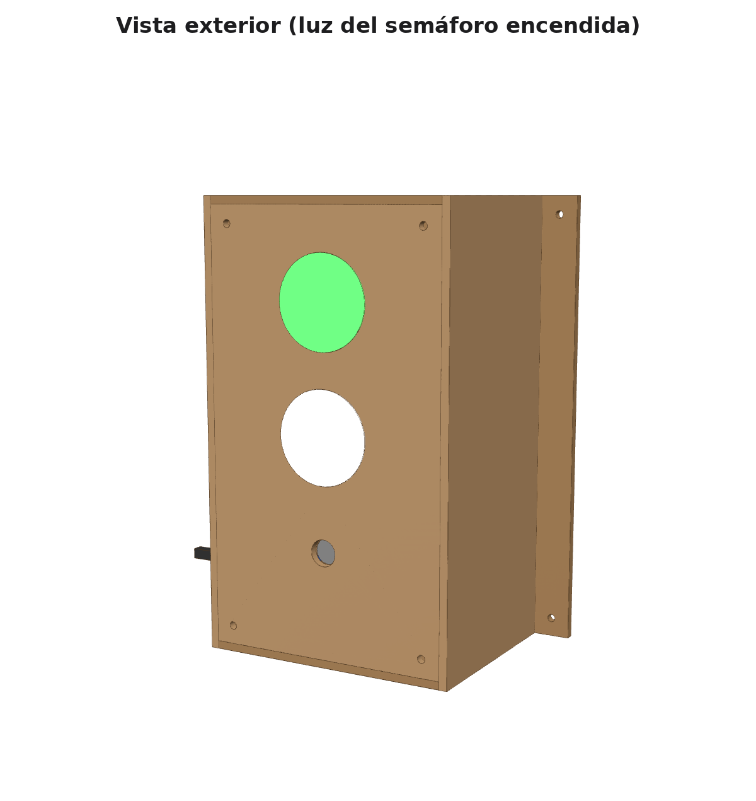
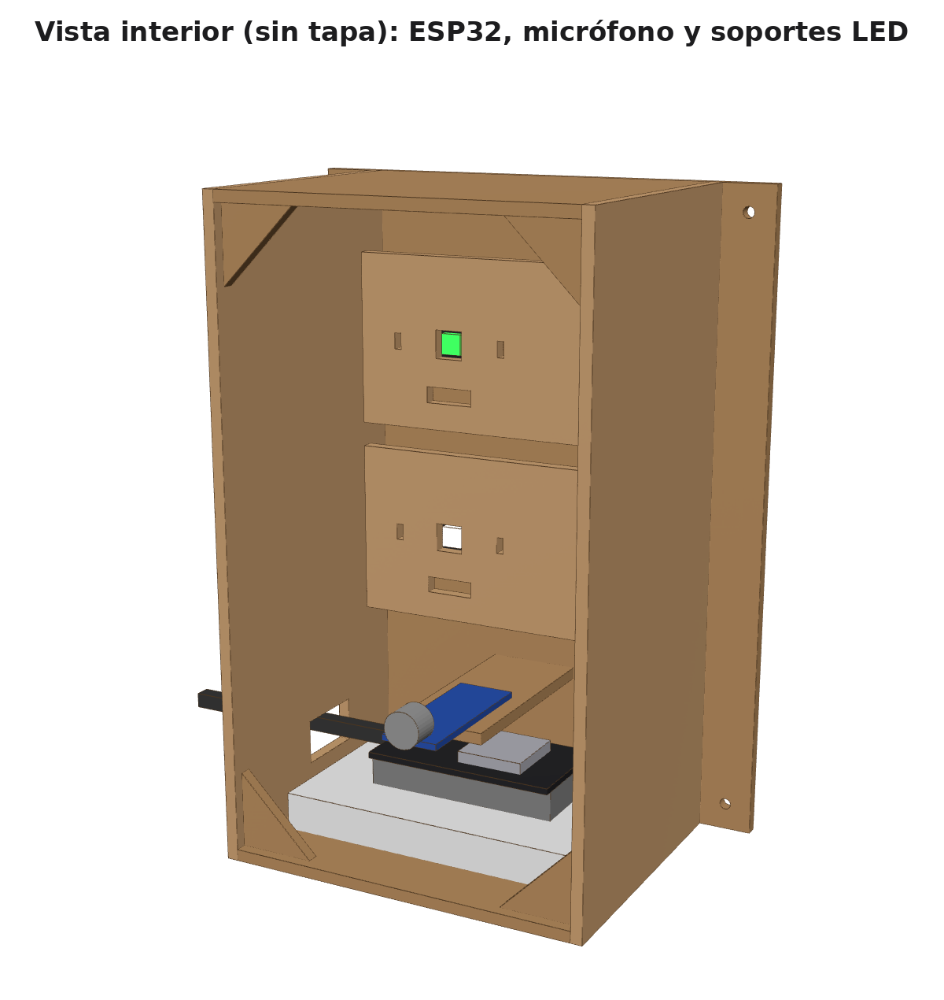
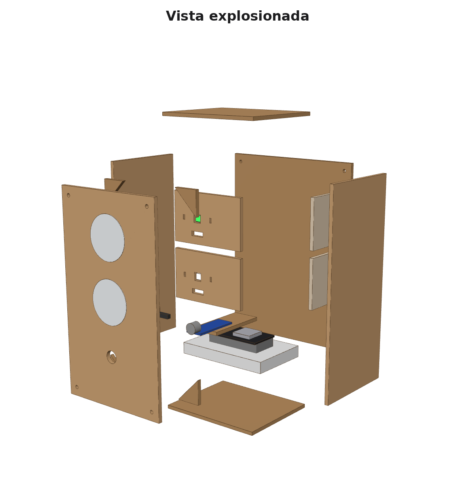
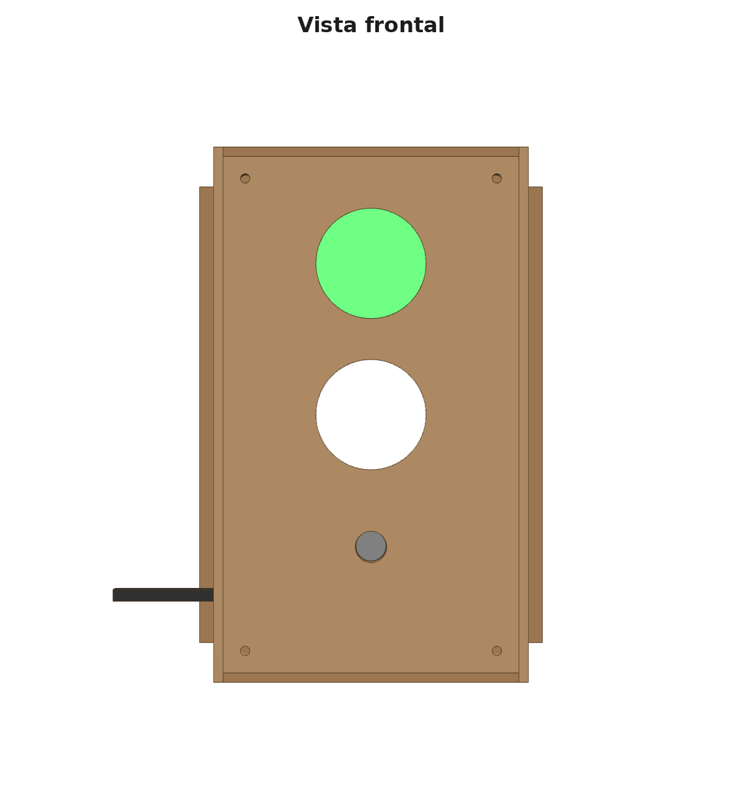
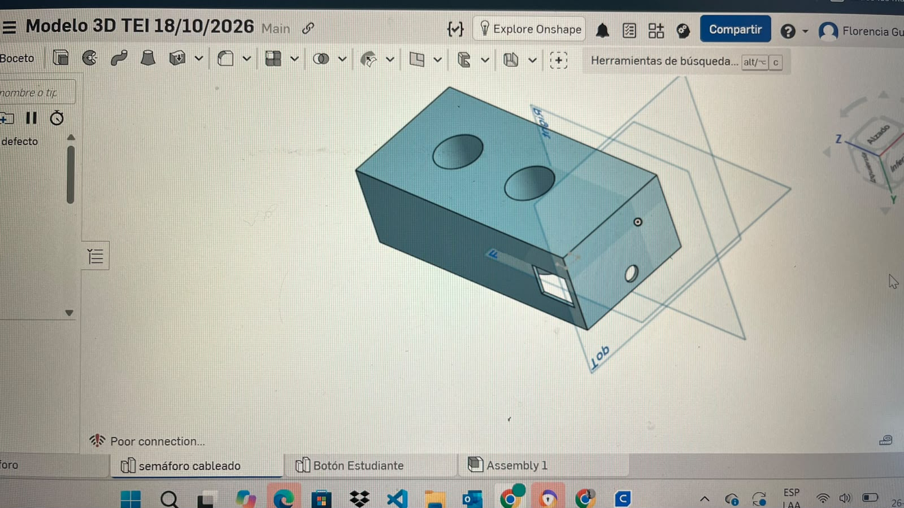
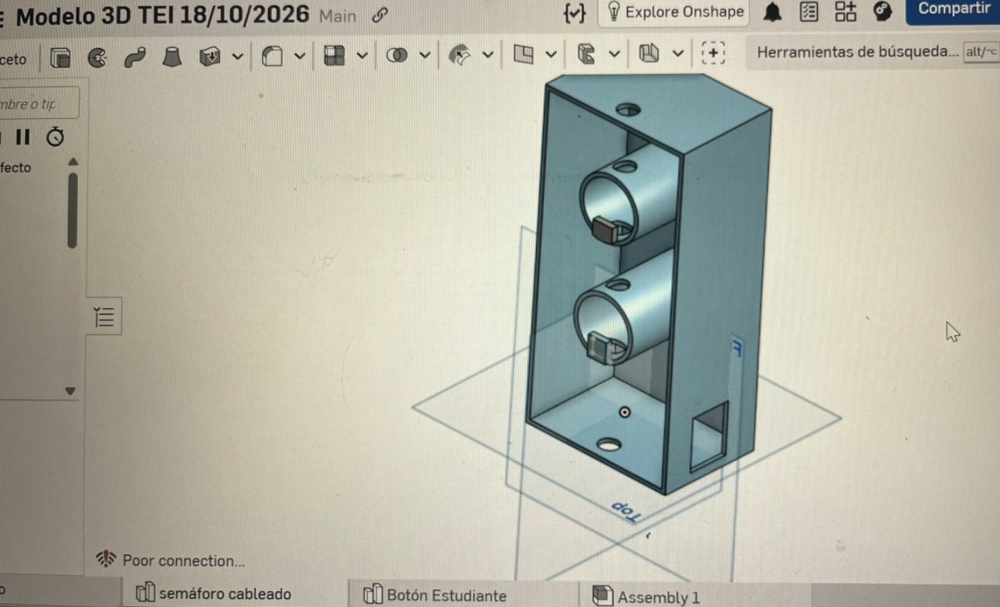

# Renders

## Versión final (v5): caja de MDF y acrílico

Caja de 10 × 17 × 8 cm cortada con láser, con el ESP32, el micrófono, los soportes de los LED y la tapa atornillada.

| Archivo | Vista |
|---|---|
| [05_v5_exterior.png](05_v5_exterior.png) | Exterior |
| [06_v5_interior.png](06_v5_interior.png) | Interior sin tapa: ESP32, micrófono y soportes de los LED |
| [07_v5_explosionado.png](07_v5_explosionado.png) | Vista explosionada |
| [08_v5_frente.png](08_v5_frente.png) | Frente |

## Versiones anteriores (Onshape)

| Archivo | Vista |
|---|---|
| [01_semaforo_exterior.jpeg](01_semaforo_exterior.jpeg) | Carcasa del semáforo, exterior |
| [02_semaforo_interior.png](02_semaforo_interior.png) | Carcasa del semáforo, interior |
| [03_boton_exterior.jpeg](03_boton_exterior.jpeg) | Carcasa del botón del estudiante, exterior |
| [04_semaforo_interior.png](04_semaforo_interior.png) | Carcasa del semáforo, interior (otra vista) |

## Pendiente

- Render de la carcasa final del botón impresa en 3D, con la ESP32-S3, la batería y el pulsador dentro.
