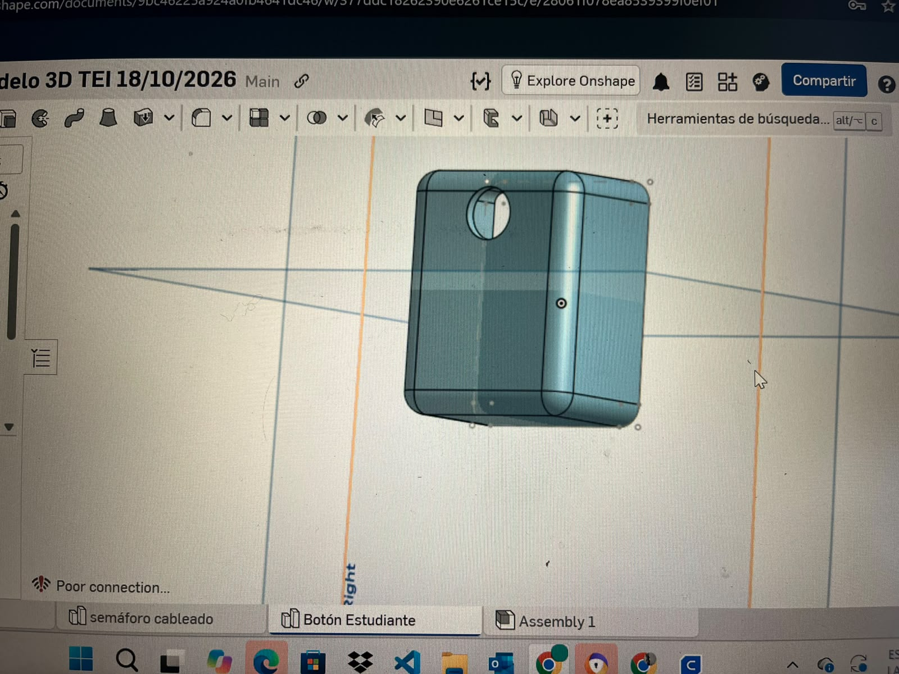
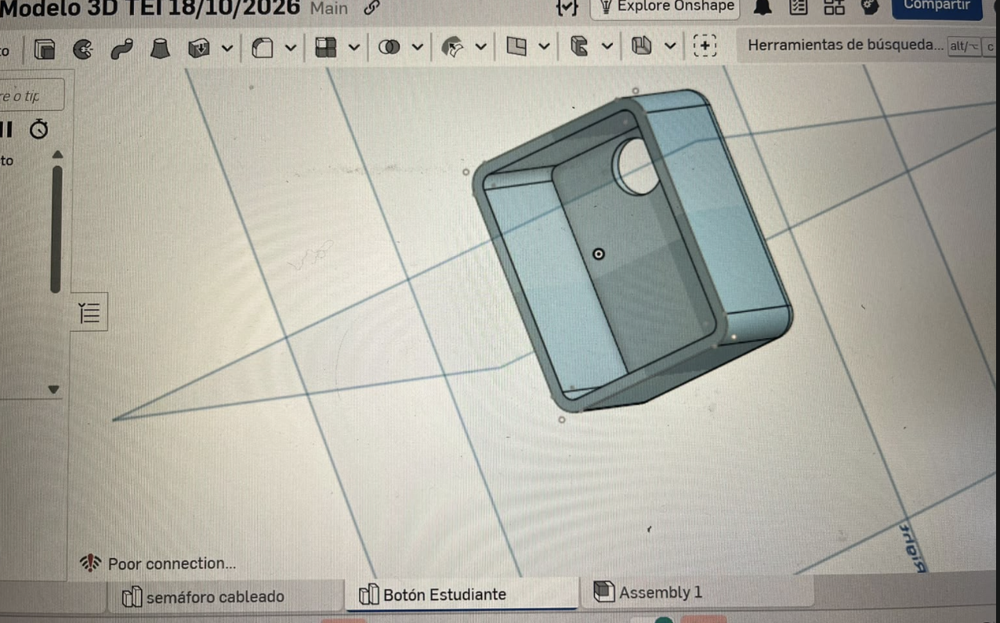

# Renders

Modelos hechos en Onshape.

| Archivo | Vista |
|---|---|
| [01_semaforo_exterior.jpeg](01_semaforo_exterior.jpeg) | Carcasa del semáforo, exterior |
| [02_semaforo_interior.png](02_semaforo_interior.png) | Carcasa del semáforo, interior |
| [03_boton_exterior.jpeg](03_boton_exterior.jpeg) | Carcasa del botón del estudiante, exterior |
| [04_semaforo_interior.png](04_semaforo_interior.png) | Carcasa del semáforo, interior (otra vista) |

## Pendiente

- Renders con todos los componentes dentro (ESP32, micrófono, LEDs y cables) y una vista explosionada.
- Versión más pequeña del botón y del semáforo, según el feedback del Avance 2.
