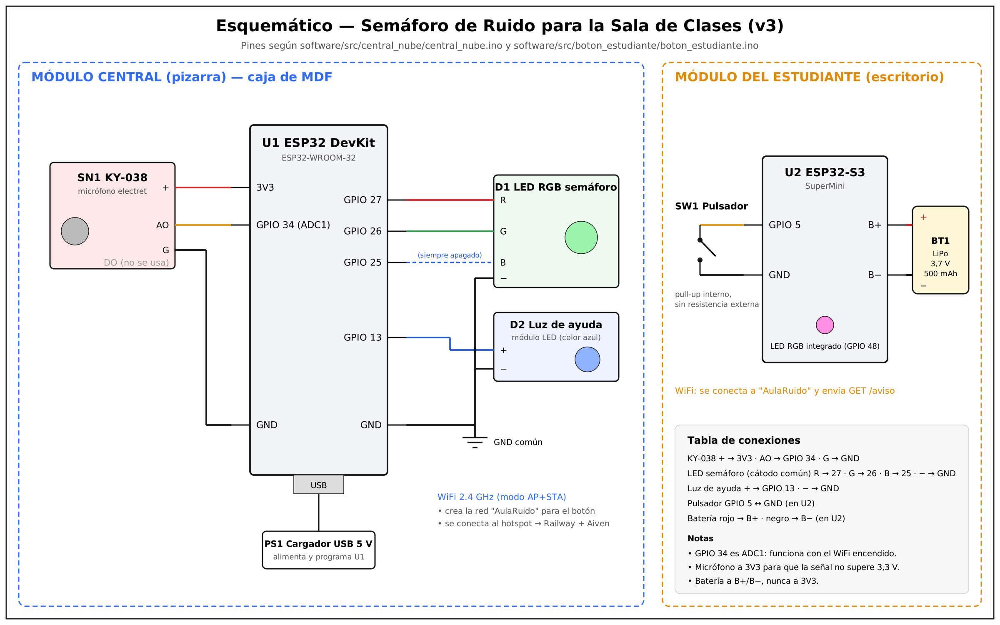
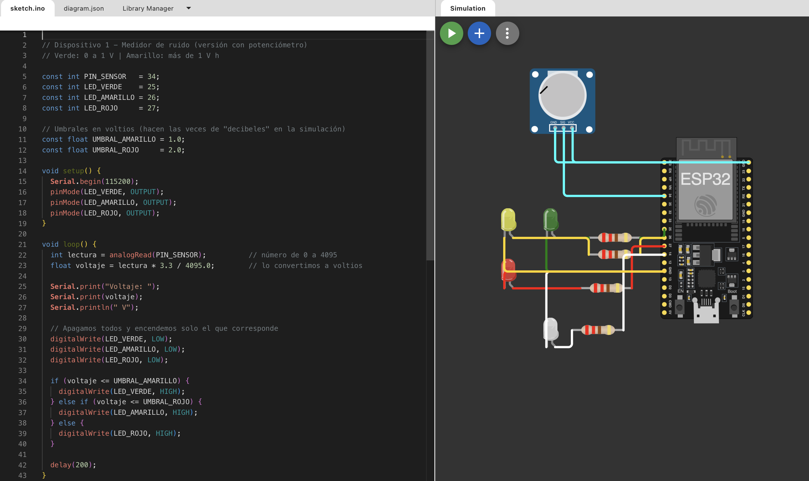

# Esquema del circuito

## Esquemático completo (versión final, v3)

Incluye los dos módulos: el central, con el micrófono, el LED del semáforo y la luz de ayuda, y el del estudiante, con el pulsador y la batería. Los pines son los de `central_nube.ino` y `boton_estudiante.ino`.

- [esquematico_v3.pdf](esquematico_v3.pdf)

## Simulación en Wokwi (primera versión)

**Proyecto:** https://wokwi.com/projects/476425261066381313

La simulación se hizo para probar la lógica del semáforo antes de tener el hardware. Se diferencia del prototipo final en lo siguiente:

- Un **potenciómetro reemplaza al micrófono KY-038**, porque Wokwi no simula sonido real. Al girarlo cambia el "nivel de ruido".
- Usa **3 LEDs separados** (verde, amarillo y rojo) en vez del LED RGB, y los pines de la primera versión.
- No incluye la luz de ayuda ni el botón del estudiante. Para eso, ver el esquemático v3 de arriba.
