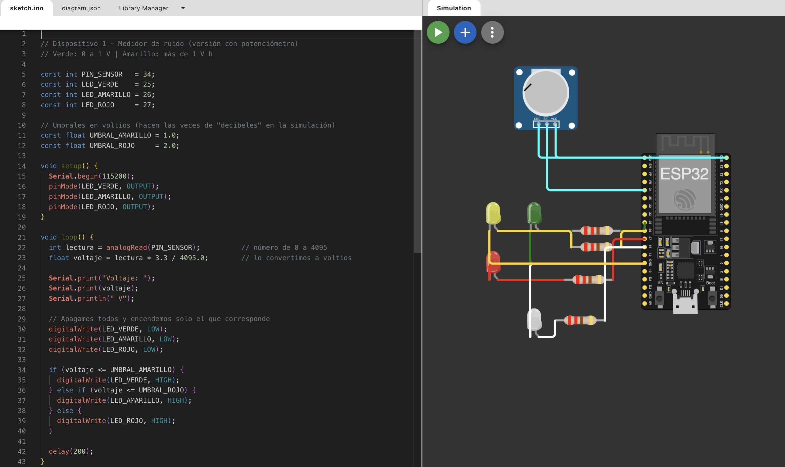

# Diagrama de Circuito

**Simulación en Wokwi:** https://wokwi.com/projects/476425261066381313

## Notas de la simulación
- En Wokwi el **potenciómetro reemplaza al micrófono KY-038**, porque Wokwi no simula sonido real. Al girarlo se cambia el "nivel de ruido".
- En la simulación se usan **3 LEDs separados** (verde → GPIO 25, amarillo → GPIO 26, rojo → GPIO 27).
- En el **prototipo real** se usa un **LED RGB** en esos mismos pines (R → 25, G → 26, B → 27), y el amarillo se forma con rojo + verde.
- El circuito completo con la luz blanca (RGB #2) y el botón del estudiante está en `hardware/bom/README.md`.
