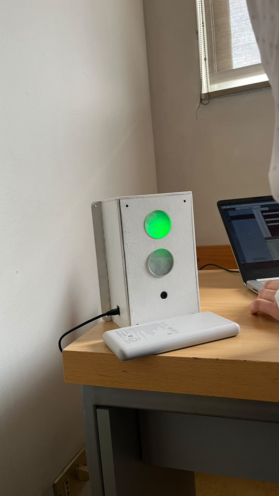
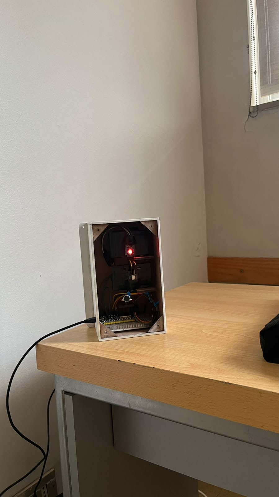
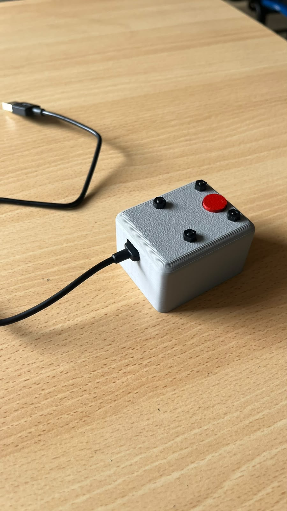

# Fotos del prototipo

Fotos del prototipo final (v3) armado y funcionando en la sala.

| Archivo | Qué muestra |
|---|---|
| [01_semaforo_encendido.jpg](01_semaforo_encendido.jpg) | Caja del semáforo cerrada y encendida en verde, alimentada por USB |
| [02_interior_abierto.jpg](02_interior_abierto.jpg) | Caja sin tapa: ESP32, micrófono KY-038 y los dos LED RGB en sus soportes |
| [03_boton_estudiante.jpg](03_boton_estudiante.jpg) | Botón del estudiante en su carcasa impresa en 3D, con el pulsador rojo |

Más fotos de las pruebas con usuarios en [testing/evidencias](../../testing/evidencias) y [testing/reportes](../../testing/reportes).
