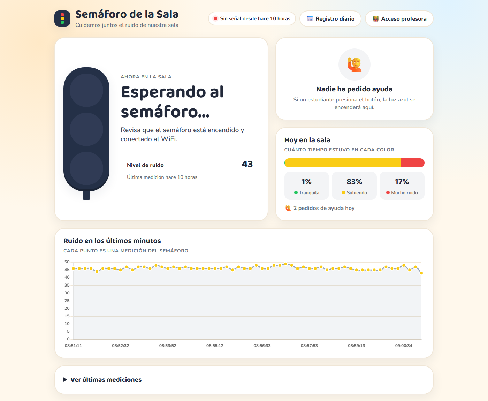

# Iteración 3, conexión a la nube y registro diario

**Versión:** v3 · **Fecha:** 20 al 22 de noviembre de 2026 · **Estado:** prototipo conectado a la nube, funcionando con el hardware real

## Por qué

El feedback del Avance 2 fue que el sistema **no estaba subido a la red**, y el próximo paso definido por el equipo era guardar los datos en una base de datos para relacionarlos con días, bloques de clase y el comportamiento del curso.

## Qué cambió respecto a la v2

| Aspecto | v2 | v3 |
|---|---|---|
| Conectividad | Red propia del ESP32, sin internet | Red propia para el botón **e** internet por hotspot al mismo tiempo (modo `WIFI_AP_STA`) |
| Datos | Se perdían al apagar | Cada 10 s se guarda el promedio del ruido y su color en PostgreSQL (Aiven). También se guarda cada pedido de ayuda |
| Página | Local, en `192.168.4.1`, solo conectándose a la red del ESP32 | Pública en https://semaforoenlinea.up.railway.app, desde cualquier celular o computador |
| Diseño de la página | Funcional | Pensado para niños: semáforo grande con emojis y mensajes cortos, colores suaves |
| Luz de ayuda | Blanca, la apagaba cualquiera | **Azul**, la apaga solo la profesora con su clave desde la página |
| Motivo del pedido | — | Al apagar la luz, la profesora elige por qué pidió ayuda el estudiante y puede escribir una nota |
| Historial | — | Registro diario con calendario, reporte de cada día, relación ruido–ayuda y descarga a Excel |
| Envíos a internet | — | En el otro núcleo del ESP32, para que el semáforo no se congele mientras se envía |
| Botón del estudiante | ESP32-C3 SuperMini con cable, LED de un color | ESP32-S3 SuperMini con batería LiPo. Su LED RGB muestra si busca la red (azul), si el aviso llegó (verde) o si no llegó (rojo) |
| Encapsulado del semáforo | Modelo en Onshape | Caja de MDF y acrílico cortada con láser (10 × 17 × 8 cm), con uniones dentadas y tapa atornillada |

## Archivos de esta versión

- Código del ESP32 central: [software/src/central_nube/central_nube.ino](../../software/src/central_nube/central_nube.ino)
- Código del botón: [software/src/boton_estudiante/boton_estudiante.ino](../../software/src/boton_estudiante/boton_estudiante.ino)
- Servidor y página: [software/web](../../software/web/README.md)
- Cómo se capturan y usan los datos: [software/docs/captura_y_datos.md](../../software/docs/captura_y_datos.md)

## Problemas encontrados y soluciones

1. **Los colores del LED salían cambiados.** El rojo se veía verde y el verde se veía azul. El código usaba R 25, G 26 y B 27, pero en el prototipo las patas estaban en otro orden. Se cambiaron los pines a R 27, G 26 y B 25 en `central_nube.ino`, y los colores quedaron correctos.
2. **Mientras se enviaba un dato, el ESP32 no atendía el botón.** Un envío HTTPS tarda 1 a 2 s. Se movieron los envíos a una tarea en el núcleo 0 del ESP32, y la medición y el botón quedaron en el núcleo 1.
3. **Avisos de ayuda que fallaban por la red.** Si el aviso no llega al servidor, el ESP32 reintenta cada 5 s hasta que se confirma.
4. **Datos sensibles.** Los motivos de los pedidos hablan de los estudiantes. Solo se muestran con la clave de la profesora, y la página sugiere no escribir nombres en las notas.
5. **La página solo mostraba las últimas 60 mediciones.** Los datos sí estaban guardados. Se agregó el registro diario para revisar cualquier día completo.

## Qué se midió

Prueba con el hardware real del 22-11-2026, de 08:00 a 09:01 (datos en [testing/datos](../../testing/datos)):

| Medida | Resultado |
|---|---|
| Mediciones recibidas por el servidor | 332 en una hora |
| Intervalo promedio entre envíos | 11.0 s (configurado en 10 s) |
| Cortes de más de 30 s | 4, el más largo de 141 s |
| Pedidos de ayuda registrados y apagados desde la página | 2 de 2 |
| Tiempo hasta que se apagó la luz | 45 s y 126 s |

## Pendiente para cerrar la versión

- Achicar el encapsulado del botón y del semáforo, según el feedback del Avance 2.
- Probar con al menos 5 usuarios en una sala real.
- Fotos del prototipo v3.
