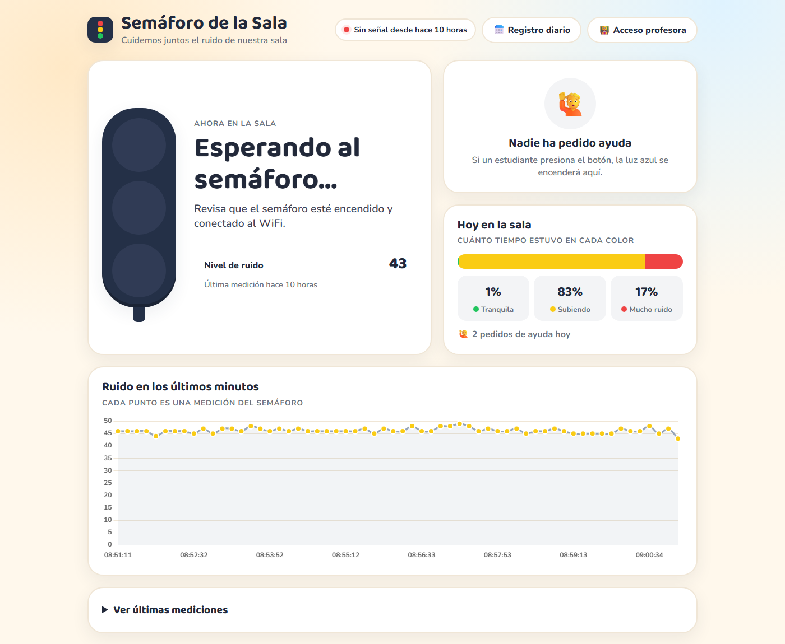
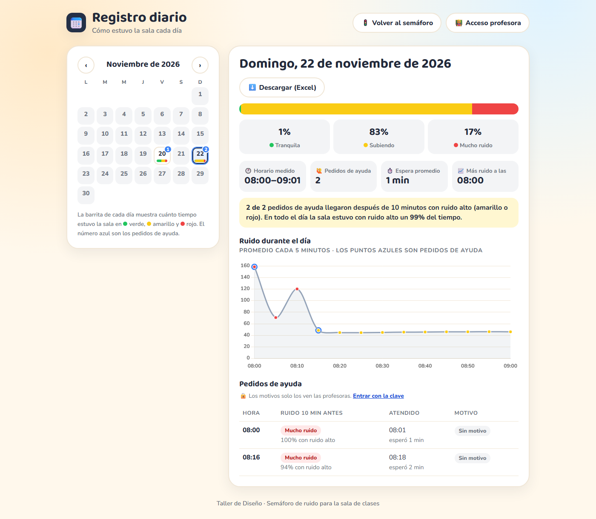

# Captura de datos, repositorio e información generada

Este documento responde a cuatro criterios de la rúbrica de Software: cómo se capturan los datos, dónde se guardan, cómo se visualizan y qué información útil se genera para el problema.

## Captura de datos

| Fuente | Qué mide | Frecuencia | Por qué esa frecuencia |
|---|---|---|---|
| Micrófono KY-038 en el ESP32 central | Amplitud del sonido de la sala (máximo menos mínimo en una ventana de 50 ms) | Una medición cada ~100 ms para el semáforo | El LED debe reaccionar al instante cuando la sala sube el volumen |
| ESP32 central hacia la nube | Promedio de la amplitud de los últimos 10 s y su color | Cada 10 s | Un promedio evita que un golpe aislado (una silla, una puerta) cuente como "mucho ruido". El registro de datos cada 10 segundos es para facilitar la evaluación , en una sala de clases real, se consideran 5 o más minutos |
| Botón del estudiante | Pedido de ayuda | Cuando se presiona | Es un evento: se registra la hora exacta. Si ya hay uno pendiente no se duplica |
| Profesora, desde la página | Hora en que atendió, motivo y nota | Cuando marca "Ya atendí" | Permite medir cuánto esperó el estudiante y por qué pidió ayuda |

**Cómo se evita perder datos o inventarlos**

- El envío a internet corre en el otro núcleo del ESP32, así que un envío lento no congela el semáforo ni hace perder presiones del botón.
- Si falla el aviso de un pedido de ayuda, el ESP32 reintenta cada 5 s hasta que el servidor lo confirma.
- Si el semáforo no manda datos por más de 60 s, la página muestra **"Sin señal"** y apaga el semáforo dibujado, en vez de mostrar un color viejo como si fuera actual.

## Repositorio de datos

Los datos se guardan en **PostgreSQL** en Aiven (plan Free), con conexión cifrada (SSL con el certificado de Aiven). El ESP32 nunca toca la base: escribe a través del servidor, que revisa la clave `x-api-key`.

| Tabla | Una fila por | Columnas |
|---|---|---|
| `lecturas` | Medición (cada 10 s) | `id`, `dispositivo`, `sensor`, `valor` (amplitud promedio), `nivel` (verde, amarillo o rojo), `creado_en` (fecha y hora con zona horaria) |
| `asistencias` | Pedido de ayuda | `id`, `dispositivo`, `pedida_en`, `atendida_en`, `motivo`, `nota` |

- Las tablas y columnas se crean solas al arrancar el servidor (`crearTablas()` en `software/web/server.js`).
- Hay un índice por fecha en cada tabla, así que buscar un día o un mes es rápido aunque haya meses de datos.
- Los días se cuentan en hora de Chile (`America/Santiago`), no en hora UTC del servidor.
- Los datos no se borran. Una clase de 6 horas genera unas 2 200 filas; el plan Free alcanza para años de uso.
- Los **motivos y notas** son datos sensibles sobre los estudiantes. El servidor solo los entrega con la clave de la profesora (`x-profe-clave`).

**Exportación:** el botón **Descargar (Excel)** del registro diario baja un `.csv` del día con los pedidos de ayuda y el ruido cada 5 minutos (separado por `;` y con BOM para que Excel en español lo abra bien). Los datos de la prueba del 22-11-2026 están en [testing/datos](../../testing/datos).

## Dashboard y visualización

Hay dos páginas, pensadas para públicos distintos.

### Semáforo de la sala (`/`), para los estudiantes

- Semáforo grande con emoji y un mensaje corto por color ("¡Qué buena sala!", "Bajemos un poquito la voz", "¡Mucho ruido!"). Está pensado para proyectarse en la sala y entenderse sin leer números.
- Tarjeta de ayuda que se pone azul y late cuando un estudiante aprieta el botón. Con la clave, la profesora la apaga con "✓ Ya atendí".
- "Hoy en la sala": porcentaje del día en cada color y cantidad de pedidos de ayuda.
- Gráfico de los últimos minutos, con cada punto del color que tenía el semáforo.
- Funciona en celular (captura en [img/pagina_celular.png](img/pagina_celular.png)).

### Registro diario (`/registro.html`), para el equipo docente

- Calendario del mes: cada día muestra una barrita con el tiempo en verde, amarillo y rojo, y un número azul con los pedidos de ayuda.
- Reporte del día elegido: porcentaje en cada color, horario medido, pedidos de ayuda, espera promedio y hora con más ruido.
- Gráfico del ruido cada 5 minutos con los pedidos de ayuda marcados en azul.
- Tabla de pedidos con el ruido de los 10 minutos anteriores, cuándo se atendió y el motivo (solo visible con la clave).

## Generación de información

El sistema no solo muestra el ruido: lo convierte en información para decidir.

| Pregunta del equipo docente | Cómo la responde el sistema |
|---|---|
| ¿Cuánto rato estuvo la sala sobre el umbral? | Porcentaje del día en amarillo y rojo, en la página y en el registro |
| ¿En qué momento de la clase sube el ruido? | Gráfico cada 5 minutos y "Más ruido a las…" |
| ¿Los pedidos de ayuda llegan después de ruido alto? | Para cada pedido se calcula el porcentaje de ruido alto en los 10 minutos anteriores, y un resumen del tipo "2 de 2 pedidos de ayuda llegaron después de 10 minutos con ruido alto" |
| ¿Por qué piden ayuda los estudiantes? | La profesora elige un motivo al atender: duda con la actividad, mucho ruido o estímulos, emoción difícil, problema con un compañero, necesidad personal u otro. El registro cuenta cuántos hubo de cada uno |
| ¿Se está atendiendo a tiempo? | Minutos de espera de cada pedido y espera promedio del día |
| ¿Mejora el curso con el tiempo? | El calendario permite comparar días y semanas, y el CSV permite analizar en Excel |

**Ejemplo real (22-11-2026):** en una hora de prueba, la sala estuvo con ruido alto el 99 % del tiempo y los 2 pedidos de ayuda llegaron después de 10 minutos de ruido alto (100 % y 94 %). La profesora los atendió en 45 s y 126 s.

## API

La lista completa de rutas está en [api.md](api.md).
